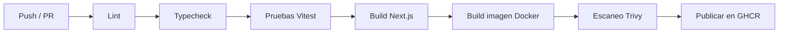

# Propuesta de proyecto: OpenGarageFlow

**Autor:** Jeisson · Ingeniería de Software, UNINPAHU
**Versión:** Mini proyecto 0.1.0 (propuesta 2)

## 1. Resumen

OpenGarageFlow es una aplicación web para que un taller automotriz organice la información de sus clientes y de los vehículos que recibe, reemplazando las listas en papel. Esta propuesta cubre el CRUD base de clientes y vehículos, y amplía el alcance con funcionalidades visibles propias de un taller real, automatización DevOps y documentación técnica completa.

## 2. Problema y objetivo

**Problema:** los talleres pequeños registran clientes, vehículos y servicios en papel o en hojas sueltas, lo que genera pérdida de información, duplicados y dificultad para consultar el historial de un vehículo.

**Objetivo general:** construir una aplicación monolítica que centralice clientes, vehículos y servicios, con control de acceso por roles, calidad verificada automáticamente y documentación que permita ejecutarla y mantenerla.

**Objetivos específicos:**

- Registrar, consultar, actualizar y eliminar clientes y vehículos, con validación de datos.
- Ofrecer consulta ágil mediante búsqueda, filtros, paginación y exportación.
- Mantener el historial de servicios de cada vehículo.
- Restringir las acciones según el rol del usuario.
- Verificar la calidad del código en cada commit y en cada push mediante automatización.
- Documentar la arquitectura, las decisiones técnicas y la ejecución del proyecto.

## 3. Alcance

**Incluido:** CRUD de clientes y vehículos, dashboard, búsqueda y filtros, paginación, exportación a CSV, detalle del cliente, historial de servicios, login con roles, pipeline DevOps y documentación.

**Fuera de alcance (versión 0.1.0):** órdenes de trabajo completas, inventario, facturación, notificaciones y carga de fotos.

## 4. Funcionalidad visible

### 4.1 Dashboard con métricas y gráficos

Página de inicio con tarjetas de resumen (total de clientes, total de vehículos, último registro) y dos gráficos: vehículos por marca y clientes registrados por mes.

### 4.2 Búsqueda, filtros, paginación y exportación a CSV

- Búsqueda por nombre, teléfono o placa.
- Filtros de vehículos por marca y por cliente.
- Paginación y ordenamiento en las tablas.
- Exportación a CSV de clientes y vehículos.

### 4.3 Detalle del cliente con sus vehículos

Vista individual con los datos del cliente y la lista de sus vehículos. Incluye la acción "Agregar vehículo" con el cliente ya preseleccionado.

### 4.4 Historial de servicios por vehículo

Cada vehículo tiene un registro cronológico de servicios con **fecha, descripción y costo**. Es la funcionalidad más cercana a la operación real de un taller y conecta con el proyecto de mayor alcance.

Nueva tabla `servicios`:

| Campo         | Tipo    | Reglas                            |
| ------------- | ------- | --------------------------------- |
| `id`          | Entero  | PK; único                         |
| `vehiculo_id` | Entero  | Obligatorio; FK de `vehiculos.id` |
| `fecha`       | Fecha   | Obligatorio                       |
| `descripcion` | Texto   | Obligatorio                       |
| `costo`       | Decimal | Obligatorio; mayor o igual a 0    |

### 4.5 Login básico con roles

| Rol           | Permisos                                                                   |
| ------------- | -------------------------------------------------------------------------- |
| Administrador | Acceso total, incluida la eliminación de registros y el dashboard completo |
| Recepción     | Crear y consultar clientes, vehículos y servicios; sin eliminar            |

Las rutas y las acciones del servidor validan el rol antes de ejecutarse.

## 5. DevOps y automatización

La calidad se verifica en tres niveles: antes del commit (local), en cada push (CI) y al construir la imagen (entrega).

### 5.1 Hooks de Git (local)

Con **Husky** y **lint-staged**, cada commit ejecuta controles automáticos sobre los archivos modificados:

| Hook         | Acción                                                                                                                              |
| ------------ | ----------------------------------------------------------------------------------------------------------------------------------- |
| `pre-commit` | ESLint y Prettier sobre los archivos en staging, verificación de tipos (`tsc --noEmit`) y pruebas unitarias relacionadas con Vitest |
| `commit-msg` | **commitlint** rechaza mensajes que no cumplan Conventional Commits                                                                 |
| `pre-push`   | Suite completa de pruebas                                                                                                           |

Un commit con errores de lint, de tipos o con pruebas fallidas no se registra.

### 5.2 Integración continua (GitHub Actions)

En cada push y pull request, el workflow ejecuta estas etapas en orden. Si una falla, las siguientes no se ejecutan.

- La publicación de la imagen en GitHub Container Registry solo ocurre en la rama `main`.
- La rama `main` queda protegida: requiere pull request y que el pipeline pase.
- **Dependabot** propone actualizaciones semanales de dependencias y de la imagen base.

### 5.3 Contenedor y entrega

- `Dockerfile` multi-etapa: imagen final liviana, con usuario sin privilegios.
- `HEALTHCHECK` sobre el endpoint `/api/health`.
- `prisma migrate deploy` se ejecuta automáticamente al iniciar el contenedor.
- Volumen para persistir el archivo SQLite.
- `docker-compose.yml` para levantar la aplicación con un solo comando.

### 5.4 Versionado y changelog

Con **release-please** (o `standard-version`), los Conventional Commits generan automáticamente el número de versión (SemVer), el `CHANGELOG.md` y el tag de cada release.

### 5.5 Pruebas

- **Unitarias (Vitest):** esquemas zod y reglas de negocio, como placa única y año válido.
- **End-to-end (Playwright):** flujo crear cliente → crear vehículo → intentar placa repetida.

## 6. Documentación

### 6.1 README

Descripción del proyecto, capturas de pantalla, insignias del pipeline (build, pruebas, versión), instrucciones de ejecución local y con Docker, y tabla de variables de entorno (`.env.example`).

### 6.2 Diagramas

- **Diagrama entidad-relación** en Mermaid: clientes, vehículos y servicios.
- **Diagrama de arquitectura**: navegador, Next.js (App Router, Server Actions), Prisma y SQLite.
- **Diagrama del pipeline** de CI/CD (sección 5.2).

### 6.3 Tabla de decisiones técnicas

| Decisión              | Justificación                                                                                  |
| --------------------- | ---------------------------------------------------------------------------------------------- |
| Next.js como monolito | Un solo despliegue, frontend y backend en el mismo proyecto, menor complejidad para el alcance |
| SQLite                | Sin servidor adicional, fácil de ejecutar en Docker y de reproducir en la evaluación           |
| Prisma                | Esquema tipado, migraciones versionadas y cliente seguro en TypeScript                         |
| zod                   | Validación única compartida entre cliente y servidor                                           |
| Husky + commitlint    | Detectar errores antes del commit y garantizar un historial uniforme                           |
| GitHub Actions + GHCR | Pipeline integrado al repositorio, sin infraestructura adicional                               |

### 6.4 Historial de commits

Commits con Conventional Commits (`feat:`, `fix:`, `docs:`, `chore:`, `ci:`, `test:`), con cambios pequeños y descriptivos, validados automáticamente por commitlint.

### 6.5 Limitaciones y trabajo futuro

- **Limitaciones:** SQLite no escala a múltiples instancias; autenticación básica sin recuperación de contraseña; sin auditoría de cambios; sin despliegue en un entorno remoto.
- **Trabajo futuro:** migración a la arquitectura del proyecto principal (monorepo con NestJS y Next.js), módulos de órdenes de trabajo e inventario, despliegue automático en un servidor, notificaciones de mantenimiento y carga de fotos del vehículo.

## 7. Stack tecnológico

Next.js (App Router, TypeScript), Prisma con SQLite, zod, Tailwind CSS con shadcn/ui, Vitest, Playwright, Husky, lint-staged, commitlint, Docker y GitHub Actions.

## 8. Plan de trabajo

| Fase             | Entregable                                                                   |
| ---------------- | ---------------------------------------------------------------------------- |
| 1. Base          | Proyecto, modelo Prisma, seed de datos, CRUD de clientes y vehículos         |
| 2. Calidad local | Husky, lint-staged, commitlint y primeras pruebas con Vitest                 |
| 3. Consulta      | Búsqueda, filtros, paginación, exportación CSV y detalle del cliente         |
| 4. Servicios     | Tabla `servicios` e historial por vehículo                                   |
| 5. Seguridad     | Login y roles                                                                |
| 6. Dashboard     | Métricas y gráficos                                                          |
| 7. Entrega       | Dockerfile, GitHub Actions, publicación en GHCR, release-please, pruebas e2e |
| 8. Cierre        | README, diagramas y changelog                                                |

## 9. Criterios de aceptación

- Un vehículo no se registra sin un cliente existente ni con una placa repetida.
- Existe al menos un cliente con más de un vehículo en los datos de prueba.
- Un commit con errores de lint, tipos o pruebas es rechazado por los hooks.
- Un mensaje de commit que no cumple Conventional Commits es rechazado.
- La aplicación se ejecuta con `docker compose up` siguiendo solo el README.
- El rol Recepción no puede eliminar registros.
- El pipeline de GitHub Actions pasa lint, tipos, pruebas, build, imagen Docker y escaneo.
