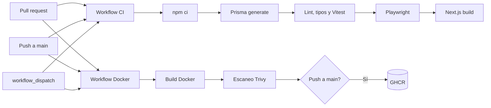

# DevOps de OpenGarageFlow

Este documento describe cómo se prepara, verifica y ejecuta OpenGarageFlow. La automatización valida el código y publica la imagen en GHCR únicamente desde `main`; no despliega la aplicación a un servidor remoto.

## Flujo general

1. Los cambios se versionan con Git y se validan por Husky antes de confirmar o enviar.
2. Al abrir o actualizar un pull request, y al enviar cambios a `main`, GitHub Actions ejecuta los workflows de CI y Docker.
3. CI instala las dependencias, genera Prisma Client y ejecuta lint, comprobación de tipos, Vitest, Playwright y compilación.
4. El workflow de Docker construye la imagen, ejecuta Trivy y publica en GHCR solo desde `main`.
5. Dependabot actualiza npm y GitHub Actions semanalmente; release-please genera cambios y releases desde commits Conventional Commits.

Ambos workflows también se pueden iniciar manualmente desde GitHub Actions mediante `workflow_dispatch`.



## Git y colaboración

Git mantiene el historial del código y permite trabajar en ramas y revisar cambios antes de integrarlos en `main`. El flujo recomendado es crear una rama por cambio, hacer commits pequeños y descriptivos, abrir un pull request y verificar que las acciones finalicen correctamente antes de integrar.

El proyecto documenta la convención Conventional Commits (`feat`, `fix`, `chore`, `docs`, `ci`) en [openspec/project.md](../openspec/project.md). Husky valida el mensaje antes del commit y pre-push ejecuta la verificación local completa.

## Integración continua: GitHub Actions

Los archivos de automatización están en `.github/workflows/`:

- [ci.yml](../.github/workflows/ci.yml), workflow **CI**: se ejecuta en pull requests, pushes a `main` y ejecuciones manuales.
  - Usa Ubuntu y Node.js 24.
  - Instala dependencias reproducibles con `npm ci`.
  - Genera Prisma Client.
  - Ejecuta lint, comprobación de tipos, Vitest, Playwright y build.
  - Define `DATABASE_URL=file:./dev.db` para la verificación.
- [docker.yml](../.github/workflows/docker.yml), workflow **Docker**: tiene los mismos eventos, construye `opengarageflow:ci` con Buildx y escanea la imagen con Trivy.
  - Solo un push a `main` inicia sesión en GHCR y publica `ghcr.io/<owner>/miniopengarageflow:latest`.
  - Las pull requests y ejecuciones manuales construyen y escanean sin publicar.
  - No realiza un despliegue.
- [release-please.yml](../.github/workflows/release-please.yml): crea releases y pull requests de release en `main` a partir de commits Conventional Commits.
- [dependabot.yml](../.github/dependabot.yml): actualiza semanalmente dependencias npm y GitHub Actions.
- [copilot-setup-steps.yml](../.github/workflows/copilot-setup-steps.yml): prepara el CLI de OpenSpec para el agente de Copilot cuando se modifica ese workflow, en pull requests que lo modifican o bajo ejecución manual.

Los comandos de verificación también se pueden ejecutar localmente:

```bash
npm run lint
npm run typecheck
npm test
npm run e2e
npm run build
npm run verify
```

## Contenedor Docker

El [Dockerfile](../Dockerfile) utiliza varias etapas para separar la instalación de dependencias, la compilación y la imagen de ejecución. La etapa final ejecuta Next.js en modo producción con el usuario sin privilegios `nextjs`, expone el puerto `3000` y conserva los datos de SQLite en `/app/data`. Su `HEALTHCHECK` consulta `GET /api/health` mediante el `fetch` integrado de Node; el endpoint informa saludable solo cuando SQLite responde.

Al arrancar, [docker-entrypoint.sh](../docker-entrypoint.sh):

1. Crea el directorio de la base de datos configurada en `DATABASE_URL`.
2. Aplica las migraciones pendientes con `prisma migrate deploy`.
3. Ejecuta `prisma/bootstrap-admin.ts` para crear el primer administrador si aún no hay usuarios.
4. Inicia el servidor de Next.js.

El bootstrap requiere `ADMIN_EMAIL` válido, `ADMIN_PASSWORD` de al menos 8 caracteres y `AUTH_SECRET` de al menos 32 bytes. Si ya hay un usuario, no cambia su cuenta ni su contraseña. Para conservar la base de datos entre recreaciones del contenedor, se recomienda montar un volumen en `/app/data`.

### Construir y ejecutar localmente

Desde la raíz del repositorio:

```bash
cp .env.example .env
# Reemplaza los valores de ejemplo por valores privados y seguros.
docker compose config
docker compose up --build -d
docker compose ps
curl http://localhost:3000/api/health
```

La aplicación queda disponible en <http://localhost:3000>. Compose entrega `ADMIN_EMAIL`, `ADMIN_PASSWORD` y `AUTH_SECRET` desde `.env`, establece `DATABASE_URL=file:/app/data/opengarageflow.db` y monta el volumen nombrado `opengarageflow-data`. Usa `APP_PORT` para elegir otro puerto de host. Al iniciar, el entrypoint aplica migraciones antes de iniciar Next.js; si una migración falla, el contenedor no arranca. `docker compose down` conserva los datos; `docker compose down -v` borra el volumen.

## Configuración y datos

- [.env.example](../.env.example) contiene nombres de variables y valores ilustrativos.
- `.env` se excluye de Git mediante [.gitignore](../.gitignore); no se deben subir credenciales ni secretos.
- La imagen excluye archivos locales según [.dockerignore](../.dockerignore).
- Para despliegues, configura los secretos en el entorno de ejecución en lugar de incluirlos en el código o en la imagen. Usa un `AUTH_SECRET` aleatorio y exclusivo por entorno, y una ruta de SQLite persistida.
- El contenedor aplica migraciones, pero no carga datos de prueba. `npm run db:seed` es el comando de desarrollo para migraciones y datos iniciales.

## Secretos y protección de `main`

La publicación GHCR usa el `GITHUB_TOKEN` proporcionado por Actions y el permiso `packages: write`; no requiere almacenar una contraseña Docker. El paquete heredará o podrá recibir permisos de acceso en GitHub. Antes de desplegar en producción, configura en el repositorio una protección externa de `main` que exija pull request, aprobaciones definidas por el equipo y los checks `verify` y `Docker` antes de integrar. También se pueden exigir mensajes firmados o revisión de código según las políticas del taller.
