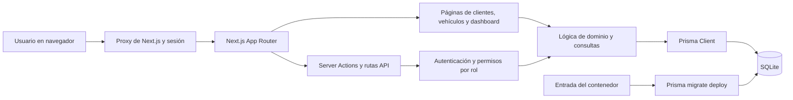
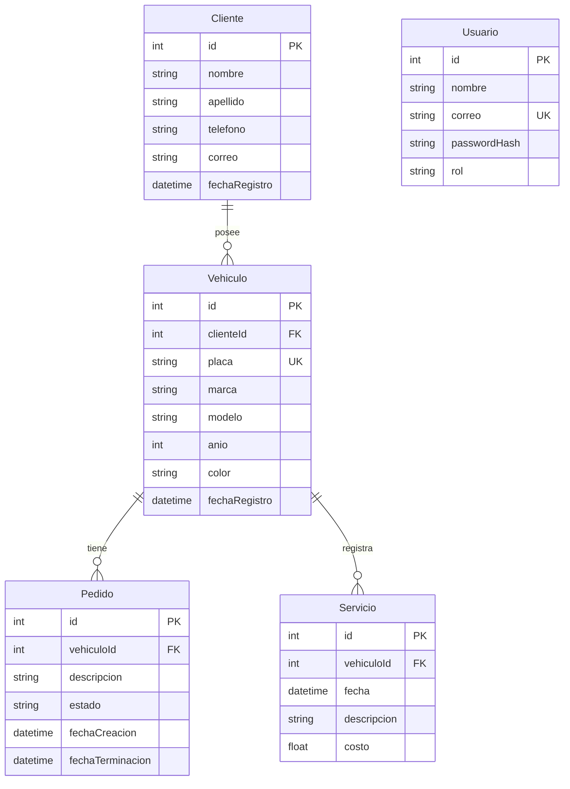

# OpenGarageFlow

OpenGarageFlow es una aplicación web para organizar la operación diaria de un taller automotriz. Permite mantener los datos de clientes y sus vehículos, registrar pedidos de trabajo y servicios realizados, y consultar un resumen del trabajo activo.

## Funcionalidades

- **Inicio / panel:** muestra pedidos pendientes, pedidos en proceso, pedidos terminados en el día y una lista de pedidos activos.
- **Clientes:** permite registrar, consultar, editar y eliminar clientes, con nombre, apellido, teléfono y correo opcional.
- **Vehículos:** permite registrar, consultar, editar y eliminar vehículos asociados a un cliente. La placa es única; año y color son opcionales.
- **Pedidos:** permite registrar, consultar, editar y eliminar pedidos asociados a un vehículo. Cada pedido tiene descripción, estado y fechas de creación y terminación.
- **Historial de servicios:** cada vehículo tiene un historial cronológico de servicios con fecha, descripción y costo. Recepción puede consultar y registrar servicios; solo Administrador puede editarlos o eliminarlos. No se puede eliminar un vehículo mientras tenga servicios asociados.
- **Roles:** Administrador gestiona todas las operaciones y crea cuentas de Recepción; Recepción puede consultar y crear registros, pero no editarlos ni eliminarlos.
- **Acceso:** incluye inicio y cierre de sesión para proteger las páginas de la aplicación.

El flujo de datos es cliente → vehículo → pedido/servicio: primero se registra un cliente, luego uno de sus vehículos y finalmente los pedidos de trabajo y los servicios realizados sobre ese vehículo. Pedido y Servicio son entidades distintas: los pedidos tienen estado y ciclo de trabajo; los servicios documentan trabajos realizados y su costo.

## Tecnologías

- Next.js 16 con App Router y React 19.
- TypeScript.
- SQLite como base de datos y Prisma como ORM y gestor de migraciones.
- Zod para validaciones.
- Vitest para pruebas.
- Docker para empaquetar y ejecutar la aplicación.
- GitHub Actions para lint, pruebas, compilación y verificación de la imagen Docker.

## Arquitectura

El dashboard está disponible para Administrador y Recepción. Sus indicadores se calculan desde las entidades `Cliente`, `Vehiculo` y `Pedido`; las páginas y acciones de escritura aplican permisos por rol en el servidor.

## Organización del código

- [src/app](../src/app): páginas, formularios y acciones de la aplicación web.
  - `customers/`, `vehicles/` y `orders/`: pantallas y operaciones de cada módulo.
  - `login/` y `auth-actions.ts`: acceso y acciones de autenticación.
  - `page.tsx`: panel principal.
- [src/lib](../src/lib): acceso a datos, lógica del dominio, Prisma, autenticación y validaciones.
- [prisma/schema.prisma](../prisma/schema.prisma): modelos y relaciones de la base de datos.
- [prisma/migrations](../prisma/migrations): historial de cambios del esquema.
- [prisma/seed.ts](../prisma/seed.ts): carga inicial para desarrollo.
- [Dockerfile](../Dockerfile) y [docker-entrypoint.sh](../docker-entrypoint.sh): construcción e inicio del contenedor.
- [.github/workflows](../.github/workflows): automatización de GitHub Actions.

## Modelo de datos

- **Cliente:** nombre, apellido, teléfono, correo opcional y fecha de registro. Un cliente puede tener varios vehículos.
- **Vehículo:** placa única, marca, modelo, año y color opcionales, fecha de registro y referencia obligatoria a su cliente.
- **Pedido:** descripción, estado, fechas de creación y terminación, y referencia obligatoria a un vehículo.
- **Servicio:** fecha, descripción, costo no negativo y referencia obligatoria a un vehículo. La relación restrictiva conserva el historial e impide borrar un vehículo con servicios asociados.
- **Usuario:** correo único, hash de contraseña y rol (`administrador` o `recepcion`). El bootstrap de Docker crea el primer administrador desde variables de entorno si no hay ningún usuario.

Las relaciones y restricciones están declaradas en [schema.prisma](../prisma/schema.prisma). La base de datos predeterminada es SQLite.

## Ejecutar en desarrollo

Requisitos: Node.js 20.9 o posterior y npm.

1. Instala las dependencias: `npm install`.
2. Copia `.env.example` a `.env` y configura `DATABASE_URL`, `ADMIN_EMAIL`, `ADMIN_PASSWORD` y `AUTH_SECRET` con valores adecuados para tu entorno.
3. Ejecuta `npm run db:seed` para aplicar migraciones y cargar los datos iniciales de desarrollo. Este seed es destructivo para los datos de taller de esa base: elimina servicios, pedidos, vehículos y clientes, y vuelve a generar los registros de demostración. Ejecútalo solo sobre una base local de desarrollo que puedas reinicializar; no lo uses para iniciar o actualizar una base de producción.
4. Inicia la aplicación con `npm run dev` y abre <http://localhost:3000>.

Para consultar un historial, abre **Vehículos** y elige **Historial de servicios** en el registro correspondiente. En esa página Recepción puede registrar servicios; el Administrador también puede editar y eliminar cada entrada. Los servicios se muestran del más reciente al más antiguo.

Los comandos de verificación son `npm run lint`, `npm test` y `npm run build`. Consulta [DevOps de OpenGarageFlow](./devops.md) para el flujo de GitHub Actions y Docker.

## Alcance operativo

La aplicación y sus datos están diseñados para ejecutarse como un monolito web con SQLite. La automatización actual verifica cambios y construye una imagen, pero no administra infraestructura, no publica la imagen en un registry ni despliega a producción. La persistencia y las copias de seguridad de la base de datos deben configurarse en el entorno donde se ejecute.
